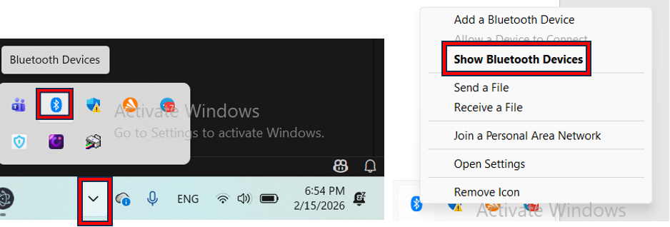
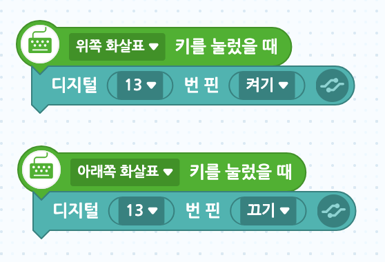

# 6.3 엔트리로 블루투스 사용하기

아두이노 우노와 블루투스 모듈(HC-05)을 PC에 먼저 연결하고, 이후 엔트리 프로그램을 통해 하드웨어와 연결하는 과정을 단계별로 설명합니다.

먼저, HC-05 모듈과 아두이노 우노는 다음과 같이 연결되어야 합니다. **주의할 점은 송수신(TX-RX)을 서로 엇갈려 연결해야 한다**는 것입니다. 우노의 TX(송신)는 블루투스 모듈의 RX(수신)와, 우노의 RX(수신)는 블루투스 모듈의 TX(송신)와 연결되어야 합니다.

<figure><figcaption></figcaption></figure>

**\[주의사항]**

* **블루투스 통신 사용시 USB로 전원을 공급하지 마십시오.** USB는 유선 통신으로 인식되어 블루투스 무선 통신과 중복되어 통신 연결 설정에 방해가 될 수 있습니다. 무선 사용 목적이라면 **우노의 전원은 배터리 등 별도 전원으로 공급해야 합니다.**&#x20;
* 만약, 현 상태에서 다시 USB 포트를 통한 유선통신을 하고자 할 때는 반대로 블루투스 모듈이 연결된 RX-TX 포트가 방해를 일으키기 때문에 **RX-TX연결된 케이블을 분리한 후, USB통신을 시도**해야 합니다.
* 블루투스를 통해서는 펌웨어 업로드가 가능하지 않은데 왜냐하면 아두이노를 업로드 가능모드로 전환시키기 위한 DTR(Data Terminal Ready) 신호를 전달할 방법이 없기 때문인데, 따라서, **펌웨어를 교체해야 한다면, 기존처럼 USB를 통한 유선통신 연결 후** 해야합니다.



### Windows 블루투스 페어링 (기기 등록)

아두이노의 블루투스 신호를 PC에서 인식하도록 설정하는 단계입니다.

1. **설정 진입**\
   작업표시줄 우측 하단의 ^ 아이콘을 눌러 블루투스 아이콘을 클릭한 뒤 \[Show Bluetooth Devices]를 선택합니다. 또는 Windows 설정(Settings)에서 블루투스 항목을 찾습니다.

<figure><figcaption></figcaption></figure>

2. **장치 추가**\
   설정 화면에서 \[Add device] 버튼을 누르고, 팝업창에서 맨 위의 \[Bluetooth] 항목을 선택합니다.

<figure><figcaption></figcaption></figure>

<figure><figcaption></figcaption></figure>

3. **HC-05 선택**\
   검색된 기기 목록에서 HC-05를 클릭합니다.

<figure><figcaption></figcaption></figure>

4. **PIN 번호 입력**\
   비밀번호 입력창에 `1234`를 입력하고 \[Connect]를 누릅니다. "Your device is ready to go!" 메시지가 나오면 성공입니다.

<figure><figcaption></figcaption></figure>



### 장치 인식 확인 (장치 관리자) — 필수 아님

**이 단계는 선택 사항입니다.** Windows가 HC-05를 제대로 COM 포트로 인식했는지 확인하려는 경우에만 수행하세요.

1. Windows 검색창에 '**장치 관리자**'를 입력하여 실행합니다.
2. Bluetooth 항목을 펼쳐 HC-05가 표시되는지 확인합니다. 이때 시스템에서 가상 통신 포트인 COM 포트가 할당됩니다.

<figure><figcaption></figcaption></figure>



### 엔트리에서 하드웨어 연결 프로그램을 통해 연결

1. **보드 선택**\
   엔트리 하드웨어 연결 프로그램을 실행하고 목록에서 **\[아두이노 우노 확장 BT]**&#xB97C; 클릭합니다.

<figure><figcaption></figcaption></figure>

2. **포트 선택**\
   '포트 선택(Select the COM PORT to connect)' 창이 뜨면 나타나는 포트(예: `COM4` 또는 `COM5`) 중 하나를 선택합니다. 포트가 2개인 것은 블루투스를 통한 양방향(입/출력) 통신채널이 생기기 때문입니다. 엔트리에서 데이터를 보내는 목적이기 때문에 출력 채널에 연결해야 합니다.

<figure><figcaption></figcaption></figure>

3. **연결**\
   \[Connect] 버튼을 눌러 상단 바의 텍스트가 "**연결 성공**"으로 변하는지 확인합니다.




### 실습 예제: 키보드 방향키로 내장 LED 제어하기

연결이 성공한 후 PC 키보드의 방향키를 눌러 아두이노 보드의 내장 LED(13번 핀)를 무선으로 끄고 켜는 예제입니다.

*   엔트리 블록 코딩 화면에서 블록을 조립합니다. 

    <figure><figcaption></figcaption></figure>

**결과 확인**

* 엔트리에서 \[시작하기]를 누릅니다.
* 키보드 **↑ (위쪽 방향키)** 를 누르면 아두이노 보드의 LED가 켜집니다.
* 키보드 **↓ (아래쪽 방향키)** 를 누르면 LED가 꺼집니다.


